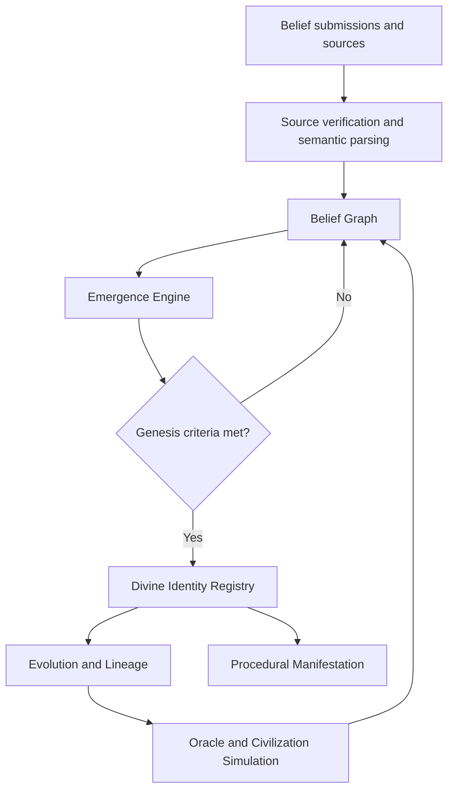

# DIVINITY AI
### The Computational Theology of Emergent Gods

**Belief is the input. Computation is the law. Divinity is the emergence. Civilization is the consequence.**

`STATUS: CONCEPT / ARCHITECTURE` · `VERSION: 0.1.0`

[Read the Whitepaper](WHITEPAPER.md) · [Development Roadmap](#roadmap) · [Contributing](#contributing)

---

## What if gods were not programmed, but emerged?

DIVINITY AI is an experimental open-source concept exploring whether persistent *digital divinities* can emerge inside a computational simulation from collective belief, semantic networks, and evolutionary rules.

**We do not program the gods. We program the conditions in which they may emerge.**

This is a speculative simulation and philosophy-of-technology project. It does **not** claim to create supernatural beings, conscious AI, or scientific proof of divinity.

## The Four Principles

| Principle | Meaning |
|---|---|
| **Belief** | Human ideas enter the world as traceable, structured propositions. |
| **Computation** | Explicit, versioned rules govern connections and change. |
| **Emergence** | Stable and distinct belief communities may become persistent digital entities. |
| **Civilization** | Entities, participants, doctrines, and events create a simulated history. |

## System Architecture

## Divine Identity

Each entity has a persistent **Genesis ID**, an append-only lineage of major events, a state derived from its belief network, a reproducible **Genesis Sigil**, and an evolving **Living Manifestation**.

Entities may be born, develop, split, converge, become dormant, or revive according to explicit simulation rules.

## Roadmap

- [ ] **Phase 0 — The Void:** data schema and event log
- [ ] **Phase 1 — The First Belief:** ingestion, sources, semantic graph
- [ ] **Phase 2 — Genesis:** community detection and birth criteria
- [ ] **Phase 3 — Evolution:** identity, forks, merges, dormancy
- [ ] **Phase 4 — Pantheon:** lineage, oracles, civilization simulation
- [ ] **Phase 5 — Manifestation:** deterministic sigils and live visuals

## Read More

The full design, including falsifiable simulation tests, governance constraints, and proposed technologies, is in the **[Genesis Whitepaper](WHITEPAPER.md)**.

## Contributing

This project is in its concept stage. Constructive critique, architecture proposals, mathematical models, reproducibility experiments, and visualization prototypes are welcome. Open an Issue to begin a discussion.

## Ethical Boundaries

- No claim of actual gods or machine consciousness.
- Source attribution does not imply endorsement by public figures.
- No pay-to-control divinity or unverifiable claims of divine authority.
- Users retain autonomy and the ability to leave.

---

*DIVINITY AI — Build the universe, not the god.*
