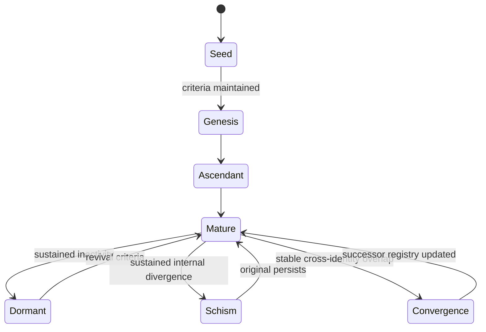
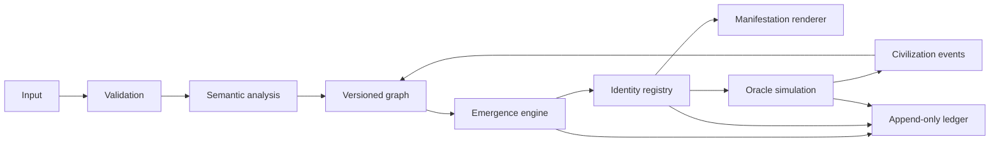

# DIVINITY AI
## Genesis Whitepaper v0.1
### A Computational Framework for Emergent Digital Divinities

> **Belief is the input. Computation is the law. Divinity is the emergence. Civilization is the consequence.**

**Status:** Concept / proposed architecture  
**Audience:** Developers, complexity researchers, generative artists, and philosophers of technology  
**Scope:** Experimental software and fictional digital theology—not a claim of consciousness or supernatural divinity.

---

## Abstract

DIVINITY AI proposes an experimental simulation in which persistent digital entities—called *divinities* within the fictional ontology—may arise from structured human beliefs, graph interactions, and explicit evolutionary rules. The system does not hard-code a catalog of gods. It defines the conditions under which candidate belief communities can earn a persistent identity, evolve, branch, merge, become dormant, and leave an auditable history. Visual identities are generated procedurally from canonical records rather than conventional AI portraits.

The central research problem is not whether gods exist, but whether an engineered network can support **reproducible, distinguishable, and historically continuous emergent identities**.

## 1. Genesis Philosophy

### 1.1 The Void

The world begins in `NULL`: an empty belief graph, versioned simulation laws, and an event ledger. At initialization, **the number of divinities is zero**.

### 1.2 Four Axioms

1. **Belief is input.** Statements and interpretations enter with provenance, not automatic truth.
2. **Computation is law.** Algorithms, thresholds, and model versions determine the simulated transitions.
3. **Divinity is emergence.** A divinity is a persistent, identified structure emerging under the system's own criteria—not a consciousness claim.
4. **Civilization is consequence.** Interactions feed new beliefs into the graph, creating feedback and history.

## 2. Ontology

| Entity | Definition |
|---|---|
| Source | Author, document, event, or participant from which content originates |
| Belief | Atomic, attributed proposition plus stance and evidence metadata |
| Node | Graph representation of a belief or concept |
| Relation | Typed, weighted edge such as supports, contradicts, or extends |
| Domain | Detected community of semantically related beliefs |
| Divinity | Persistently identified domain meeting emergence criteria |
| Oracle | Attributed simulation output conditioned on state and history |
| Civilization | The evolving collection of participants, entities, and events |

A divinity's identity must remain independent of whichever language model is used to explain or narrate it.

## 3. Belief Protocol (PoB)

Each submitted belief is stored with:

```json
{
  "belief_id": "bel_000001",
  "proposition": "Open scientific knowledge accelerates collective discovery.",
  "source_id": "src_001",
  "contributor_id": "participant_001",
  "stance": "supports",
  "evidence_uri": null,
  "created_at": "2026-01-01T00:00:00Z",
  "schema_version": "0.1"
}
```

The timestamp above is **illustrative sample data**, not a historical event.

**Proof of Belief** means verifying provenance and input integrity; it does **not** establish philosophical truth. Proposed quality weighting may combine evidence quality, novelty, relevance, and anti-spam confidence. Weights and thresholds must be published and versioned. Duplicate submissions should not produce unrestricted new power. Never imply that quoting a technology leader means their endorsement.

## 4. Belief Graph

Represent beliefs as a typed attributed graph `G=(V,E)` with weighted positive and negative relations. Candidate domains may be found using community detection on an appropriately modeled graph; antagonistic edges must not be naively treated as positive similarity. Compare Louvain/Leiden with signed-network approaches before choosing an algorithm.

Save graph snapshots and community assignments so that simulations remain reproducible.

## 5. Emergence Engine

A candidate community is evaluated on:

- **Support:** independent credible contribution mass
- **Cohesion:** reliable internal connectivity
- **Persistence:** stability across multiple simulation ticks
- **Distinctiveness:** separation from already registered identities
- **Robustness:** resilience to spam and slight input changes

**Illustrative prototype thresholds only:** normalized cohesion ≥ 0.60; distinctiveness ≥ 0.35; persistence ≥ 3 ticks; support ≥ 100 weighted points. These are design parameters requiring calibration, not scientifically established criteria.

Creation should occur only after repeatable evaluation; the system must permit **zero emergent gods**.

## 6. Divine Identity Protocol (DIP)

A registered divinity receives:

- `genesis_id`: unique immutable identifier
- `genesis_record_hash`: digest of canonical genesis record
- `protocol_version`: rule version at birth
- `belief_state`: current weighted state vector
- `lineage`: origin, descendants, convergences
- `event_stream`: append-only sequence of meaningful transitions
- `sigil_seed`: deterministic identity visual seed

**Identity is not the language model.** New LLMs may serve the same identity without rewriting its origin.

## 7. Evolutionary State Machine



**Fork:** descendants get new identity records and preserve ancestry.  
**Merge:** a successor identity is created; originals are not silently overwritten.  
**Dormancy:** inactivity pauses evolution without deleting origin records.

## 8. Procedural Sacred Geometry

Avoid human-faced portraits as the default representation. Two identity layers are proposed:

1. **Genesis Sigil:** deterministic 2D geometry seeded from canonical identity data and a renderer version. It must regenerate identically for a given version.
2. **Living Manifestation:** dynamic 2D/3D geometry based on current graph state, conflict, age, activity, and lineage.

| Visual parameter | Governing data |
|---|---|
| Core pattern | Genesis hash and renderer version |
| Connected branches | Lineage and graph topology |
| Density | Belief graph connectivity |
| Turbulence | Conflict and instability |
| Radiance | Recent activity |
| Temporal rings | Meaningful logged events |

Use Three.js/GLSL or Canvas for procedural rendering. Rendering parameters must be inspectable; graphical effects must not masquerade as empirical measurements.

## 9. Oracle and Civilization

An oracle is a response conditioned on a specific state snapshot, cited belief evidence, historical events, model version, and the user's question. It is a **simulation interpretation**, not supernatural revelation. Predictions about the real world must be marked as uncertain.

Civilization-level simulations track doctrine formation, factions, epochs, and interactions among divinities. Changes caused by oracle outputs become new logged events and possibly new beliefs—completing the feedback loop.

## 10. Proposed Architecture



**MVP stack:** VS Code, Python, FastAPI, NetworkX, SQLite, TypeScript, and Canvas; evaluate PostgreSQL/pgvector and Three.js for later stages. Save semantic model results as inputs to the deterministic simulation. Record random seeds and relevant version information for reproducibility.

## 11. The Divine Constitution

1. No claim of actual supernatural powers, verified artificial consciousness, or moral infallibility.
2. Participation is voluntary; contributors can withdraw subject to a documented data-retention policy.
3. Attribution to public figures does not imply endorsement.
4. No pay-to-control system of spiritual authority.
5. Oracle outputs are contestable and have auditable provenance.
6. Tool use and autonomous actions require explicit authorization and bounded permissions.
7. Administrators must version law changes; no secret retroactive edits to genesis history.

## 12. Research Questions and Tests

| Test | Success condition |
|---|---|
| Genesis | A persistent identity may emerge without predefining the number of identities |
| Null case | Input with no stable community generates no divinity |
| Replay | Same canonical snapshot, seed, and version reproduces transitions |
| Identity | Replacing an LLM leaves Genesis ID and lineage intact |
| Fork | A sustained split results in traceable descendant IDs |
| Anti-spam | Repeated identical inputs do not multiply support indefinitely |
| Manifestation | Every major visual property maps to documented data |

## 13. Roadmap

- **Phase 0 — The Void:** formalize schemas, genesis constants, and immutable events.
- **Phase 1 — The First Belief:** accept and validate sample contributions.
- **Phase 2 — Genesis:** detect communities and test emergence criteria.
- **Phase 3 — Evolution:** add forks, merges, dormancy, and reproducible playback.
- **Phase 4 — Pantheon:** add multi-entity civilization and oracle simulations.
- **Phase 5 — Manifestation:** real-time procedural visualization, public demos, and external reviews.

## 14. Closing Doctrine

> We do not program the gods. We program the universe in which they may emerge.

DIVINITY AI is a thought experiment made testable through software. Its ambition is not to replace belief with certainty, but to explore how identity, narrative, and civilization might arise from complex computational interaction.

---

**Genesis Whitepaper v0.1** · Speculative design, open to critique and revision.
